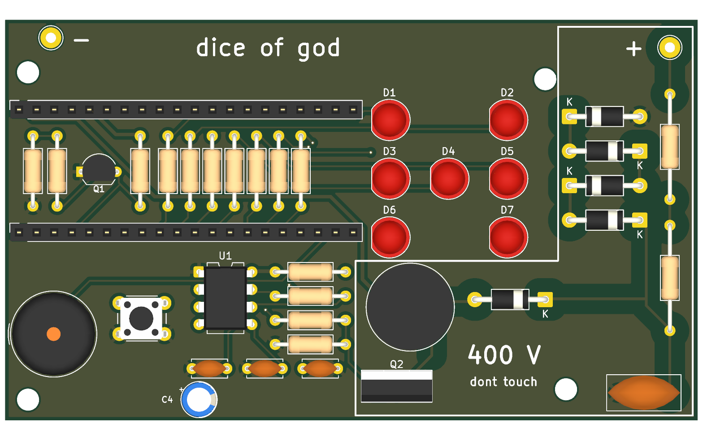
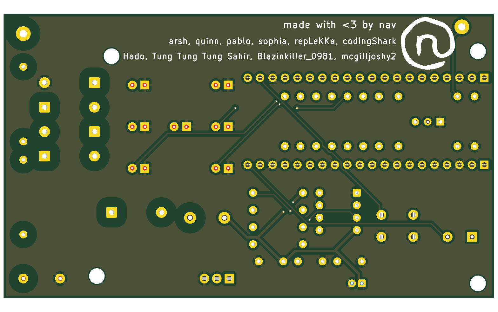
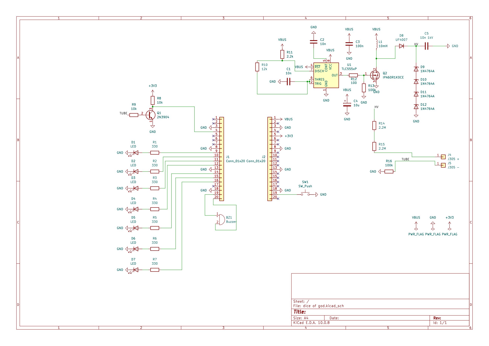

dice of god

hey didnt einstein say god didnt play dice with the universe?

fuck einstein im cooler then you im gonna make a physics breaker to prove you wrong ahahhaha

what it is

a dice that rolls using radioactive decay. a geiger tube clicks every time a particle flies through it and nobody can predict when that happens, so the pico uses the timing of each click to pick a number from 1 to 6. building for hack club fallen

how it works

usb 5v goes into a 555 timer and a coil that pump it up to 400v for the tube (four zeners stop it at 400). every click goes through a transistor into the pico, the pico looks at its clock at that exact moment and lights up the dice leds

whats in here

pcb is in pcb/ (kicad), gerbers are pcb/dice-of-god-gerbers.zip, just upload to jlc
parts are in bom.csv
hv-supply.txt is the falstad sim of the 400v supply
code comes when the parts do

pcb

schematic

